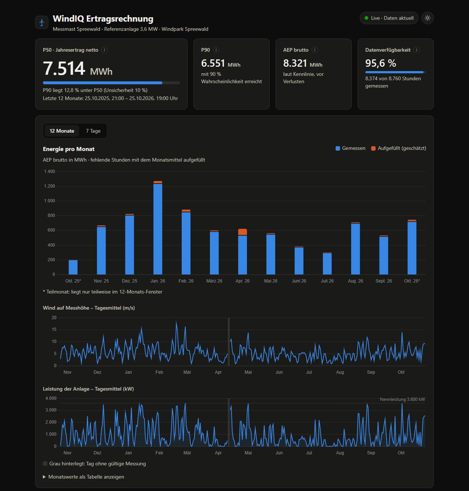

# WindIQ – Live-Ertragsrechnung

Holt stündliche Messwerte eines Messmasts aus der WindIQ-API, bereinigt sie, berechnet laufend den Jahresenergieertrag (AEP brutto/netto, P50, P90) der letzten 12 Monate und zeigt das Ergebnis in einem Dashboard.

| | |
|---|---|
| **Dashboard** | https://windiq-api.sliplane.app/ (7-Tage-Ansicht: [/#7-tage](https://windiq-api.sliplane.app/#7-tage)) |
| **API-Dokumentation** | https://windiq-api.sliplane.app/docs |
| **Statusseite** | https://stats.uptimerobot.com/MPXGp73ORH |



---

## Überblick

```
             WindIQ-API (Mast, Anlage, Standort, Messwerte)
                          ▲  alle 15 min (:00/:15/:30/:45) – nur Änderungen seit dem letzten Sync
                          │
 ┌─ Sliplane ─────────────┼───────────────────────────────────────────────────────┐
 │  windiq-api (Docker)   │                                                        │
 │   ├─ Sync (Hintergrund-Thread): Client → Mapper (bereinigen) → Upsert          │
 │   ├─ REST-API: /api/yield, /api/recent, /api/status, /health/*                 │
 │   └─ Dashboard: statische Seite unter /                                        │
 │                │                                                               │
 │  windiq-db (PostgreSQL 17 / PostGIS, nur intern erreichbar)                    │
 └────────────────────────────────────────────────────────────────────────────────┘
      ▲ Deploy nur nach grünen Tests            ▲ Prüfung jede Minute / alle 5 min
 GitHub Actions (Tests + Docker-Build)    Sliplane-Healthcheck + UptimeRobot
```

**Stack:** Python 3.13, FastAPI, SQLAlchemy 2, Alembic, PostgreSQL/PostGIS, httpx, pytest · Dashboard: HTML/CSS/JavaScript + Chart.js · Docker, GitHub Actions, Sliplane, UptimeRobot.

---

## Ertragsrechnung

Formeln wie in der Aufgabe. Stand der Stammdaten am 25.10.2026: Messhöhe 100 m, Nabenhöhe 140 m, α = 0,2, Verluste 3 % / 2 % / 5 %, U = 10 %.

1. **Nabenhöhe:** `v_Nabe = v_Mess × (h_Nabe / h_Mess)^α` → Faktor 1,0696, aus den aktuellen API-Werten berechnet (nicht fest eingetragen).
2. **Leistung je Stunde:** Kennlinie **linear** zwischen den Stützpunkten (1-m/s-Raster). Unter Cut-in (3 m/s) und über Cut-out (25 m/s) **0 kW** – die Kennlinie liefert für 2–3 m/s sonst Leistung, und über 25 m/s wäre sie nicht definiert.
3. **AEP brutto:** Summe über die **letzten 12 Monate bis zur aktuellen Stunde** (8.760 h, im Schaltjahr 8.784).
4. **AEP netto** = brutto × (1 − Verfügbarkeit) × (1 − elektrisch) × (1 − Abschattung); **P50** = netto; **P90** = P50 × (1 − 1,282 × U).

**Lücken:** Fehlende oder ungültige Stunden werden **je Kalendermonat mit der mittleren Leistung dieses Monats** aufgefüllt (ein Monat ganz ohne gültige Werte: Mittel des Zeitraums). Begründung:
- Eine Lücke heißt, der *Mast* hat nicht gemessen – nicht, dass die *Anlage* stand. Stillstand steckt bereits in „Verfügbarkeit“; Lücken als 0 kWh zu zählen, zöge ihn doppelt ab.
- Monatsweise statt Jahresmittel, weil Wind stark saisonal ist (Januar 2026 ≈ 1.700 kW mittlere Leistung, Juli ≈ 410 kW).
- Das Dashboard zeigt gemessene und aufgefüllte Energie getrennt sowie die Datenverfügbarkeit.

**Absicherung:** Unit-Tests rechnen echte Stunden per Hand nach (25.10.2026 08:00 UTC: 11,44 m/s → 12,2363 m/s auf Nabenhöhe → 3.536,5 kW). Zusätzlich liefern ein unabhängiges Analyse-Skript und der Produktionscode auf denselben Daten exakt dasselbe Ergebnis (8.314,5 MWh brutto).

---

## Datenqualität

Die API ist laut Aufgabe „nicht perfekt“. Gefunden in den Daten (12 Monate, Stand 25.10.2026) und so behandelt:

| Befund | Häufigkeit | Behandlung |
|---|---|---|
| HTTP 503 (nicht dokumentiert) | sporadisch | Retry mit exponentiellem Backoff (2/4/8/16 s), 4xx wird nicht wiederholt |
| Token läuft nach 1 h ab | – | wiederverwenden, 60 s vor Ablauf erneuern, bei 401 einmal neu anmelden |
| Windgeschwindigkeit als Text (`"7.47"`) | 33 | in Zahl umwandeln; nicht lesbar → ungültig |
| `null` | 30 | ungültig (Lücke) |
| Einheit `km/h` statt `m/s` | 349 (in Blöcken à 72 h) | ÷ 3,6 – ohne Umrechnung wäre AEP brutto **+12,6 %** zu hoch |
| `-999` (nicht dokumentiert) | 42 | Fehlercode → ungültig; wird **vor** der Einheiten-Umrechnung erkannt |
| negative Werte (−0,2 … −2,9 m/s) | 16 | ungültig – 13 davon liegen zwischen Stunden mit 4–10 m/s, also kein Windstille-Rauschen |
| über 40 m/s (60–83 m/s) | 12 | ungültig – einzelne Spitzen; höchster echter Wert 23,7 m/s (Sturm 18.02.2026), Orkan beginnt bei 32,7 m/s |
| **eingefrorener Windmesser** (4–8 h exakt gleicher Wert, Richtung dreht weiter) | 41 Folgen, 252 h | ab 3 gleichen Werten: erster gilt, Wiederholungen ungültig (Zufall: ~1:178 je Stunde) |
| Duplikate (`…Z` vs. `…+00:00`), Zeitstempel in `+02:00` | 19 / 720 | alles nach UTC; Zeitstempel ist Primärschlüssel |
| nachträgliche Korrekturen (`version` 2/3) | 1.665 | Abruf über `updated_since`; höhere Version gewinnt |
| verspätete Lieferung: 95,6 % der Werte kommen 1–10 min nach Stundenbeginn, der Rest 2–24 h später (dazwischen nie) | 307 (4,4 %) | über `updated_since` automatisch nachgeholt; `/health/data` toleriert eine einzelne verspätete Stunde |
| Stammdaten ändern sich (z. B. `wake` 0,06 → 0,05) | live beobachtet | bei jedem Sync neu geholt, mit Version gespeichert und angezeigt |

Rohwert, Einheit und Grund (`quality`) werden je Stunde gespeichert – jede ungültige Stunde ist nachvollziehbar.

---

## Sync und Datenhaltung

- **Wann:** beim Start sofort, danach um :00/:15/:30/:45 (Hintergrund-Thread im API-Prozess).
- **Was:** Mast, Anlage, Standort (geprüft mit Pydantic – z. B. Verluste müssen Anteile < 1 sein, Kennlinie sortiert; bei Unsinn bleibt der letzte gültige Stand), danach alle Messwerte mit `updated_at ≥ letzte bekannte Änderung − 2 h` → neue, verspätete und korrigierte Werte.
- **Speichern:** `INSERT … ON CONFLICT (timestamp) DO UPDATE … WHERE alte Version < neue Version`, Seite für Seite committet. **Idempotent:** ein wiederholter oder abgebrochener Lauf richtet keinen Schaden an.
- **Fehler** werden geloggt und beim nächsten Lauf erneut versucht; die App läuft weiter.
- **Ergebnis** wird bei jeder Anfrage aus der DB neu berechnet (~40 ms) – keine Zwischenergebnisse, die veralten könnten.

---

## Betrieb

| Ebene | Was | Alarm |
|---|---|---|
| `GET /health` | Prozess lebt | – |
| `GET /health/ready` | Datenbank erreichbar | Sliplane-Healthcheck (jede Minute, Mail nach 3 Fehlschlägen; gated auch Deploys) + UptimeRobot |
| `GET /health/data` | neuester Messwert jünger als 2,5 h | UptimeRobot (zeigt: die App erfüllt ihren Zweck, nicht nur „Server läuft“) |
| `GET /api/status` | letzter/nächster Sync, Fehler, Anzahl Werte je Qualität | Dashboard-Karte „Betrieb“ |

**CI/CD** (`.github/workflows/ci.yml`): bei jedem Push Tests (gegen echtes PostgreSQL als Service-Container) und Docker-Build parallel; nur wenn beide grün sind und auf `main` gepusht wurde, ruft die Pipeline den Sliplane-Deploy-Hook auf (Sliplanes Auto-Deploy ist aus). Beim Container-Start laufen die Alembic-Migrationen; schlägt eine fehl, startet die neue Version nicht und die alte läuft weiter.

---

## Projektstruktur

```
backend/
├── app/
│   ├── api/routers/        HTTP-Endpunkte (health, status, yield)
│   ├── services/           Abläufe: Sync, Zeitplan, Ertrag
│   ├── domain/             Rechenkern – reine Funktionen, kein I/O
│   ├── integration/        WindIQ-API: Client (Token, Retry, Pagination), Rohformate, Mapper (Bereinigung)
│   ├── repositories/       Datenbankzugriff (Upsert, Abfragen)
│   ├── models/             SQLAlchemy-Entitäten
│   ├── core/               Konfiguration, DB-Verbindung
│   └── static/             Dashboard (wird vom Backend unter / ausgeliefert)
├── alembic/versions/       Migrationen
├── tests/                  59 Testfunktionen (84 Testfälle)
└── Dockerfile
docker-compose.yml          lokale Datenbank + API
```

Das Dashboard liegt bewusst im Backend: eine statische Seite ohne Build-Schritt, ein Service, ein Deployment. Bei einem größeren Frontend (z. B. Next.js) käme ein eigenes `frontend/` mit eigenem Container dazu.

---

## Lokal starten

Voraussetzungen: Docker, [uv](https://docs.astral.sh/uv/).

```bash
cp .env.example .env               # WINDIQ_CLIENT_ID und WINDIQ_CLIENT_SECRET eintragen
docker compose up -d --build       # PostgreSQL + API → http://localhost:8000
```

Entwicklung ohne Container für die API:

```bash
docker compose up -d db
cd backend
uv sync
uv run alembic upgrade head
uv run uvicorn app.main:app --reload
uv run pytest                      # nutzt eine eigene Test-Datenbank windiq_test
```

---

## Arbeitsweise

Entwickelt mit KI-Unterstützung (Claude Code); Architektur und fachliche Entscheidungen habe ich getroffen und geprüft.
